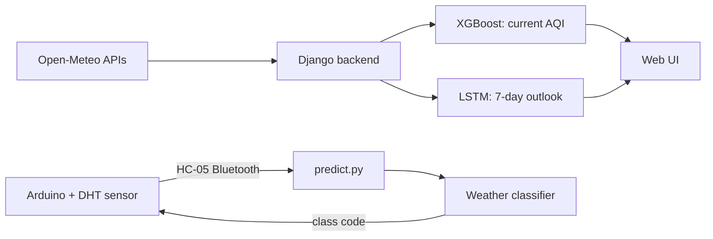

<<<<<<< HEAD
# AQI Forecaster + Weather Station

A machine-learning project that estimates and forecasts India's Air Quality Index (AQI) from pollutant and weather data, shows live conditions for any Indian state, and includes an Arduino-based hardware module that classifies the weather from temperature and humidity.

The project has two parts:

| Part | What it does | Folder |
|---|---|---|
| **AQI web app** | Django app with an XGBoost AQI estimator, an LSTM 7-day outlook and live data from Open-Meteo | `aqi_forecaster_with_openmeteo/` |
| **Hardware module** | Arduino + HC-05 Bluetooth sends temperature and humidity to Python, which classifies the weather and replies | `with_hardware/` |

---

## Features

- **Live AQI estimate:** edit 10 pollutant and weather inputs and get an AQI value, a CPCB category and health advice instantly.
- **Live data for any Indian state or UT:** fetches the last 24 hours of pollution and weather data from [Open-Meteo](https://open-meteo.com/) (no API key needed), then shows a 24-hour chart and table.
- **7-day outlook:** an LSTM takes a 24-step history window and produces a 7-day AQI trend (rising, falling or stable).
- **Quick scenario presets:** monsoon, typical and smog conditions to see how the model reacts.
- **Hardware weather classifier:** a sensor on an Arduino sends temperature and humidity over Bluetooth, and a trained classifier returns one of 8 weather classes.
- **Robust inference:** XGBoost loads through three fallbacks (native booster, a pure-numpy tree evaluator, then the pickle) so the app still runs if library versions differ.

---

## System architecture



---

## Models and results

### AQI regression (3 models compared)

The same task was trained with three algorithms and evaluated on a held-out test set:

| Model | MAE | RMSE | R² |
|---|---|---|---|
| Random Forest | 0.0526 | 0.8125 | 1.0000 |
| XGBoost | 0.7597 | 2.3567 | 0.9997 |
| ANN | 0.4131 | 0.5663 | 1.0000 |

> **Note on the near-perfect scores:** AQI is calculated directly from pollutant concentrations using the CPCB formula, so these models are essentially learning that formula. The results show the models reproduce it very closely, but they do **not** show the ability to forecast future air quality. See [Limitations](#limitations).

The web app currently serves the **XGBoost** model (`aqi_xgboost_model.json` / `.pkl`).

### LSTM (7-day outlook)

- Input: 24 time steps × 12 features (latitude, longitude, PM2.5, PM10, NO2, SO2, CO, O3, temperature, humidity, wind speed, rainfall)
- Features scaled with a fitted scikit-learn scaler (`lstm_X_scaler.pkl`)
- Forecast is produced by rolling the window forward one step at a time
- Test metrics: _add your LSTM MAE / RMSE / R² here_

### Weather classifier (hardware module)

- Model: `RandomForestClassifier(random_state=42)`
- Inputs: temperature (°C) and relative humidity (%)
- Output: 8 weather classes (codes 0 to 7, decoded by `label_encoder.pkl`)
- Test set: 31,111 samples

| Metric | Value |
|---|---|
| Accuracy | **82.06%** |
| Macro avg F1 | 0.82 |
| Weighted avg F1 | 0.82 |

Per-class performance:

| Class | Precision | Recall | F1 | Support |
|---|---|---|---|---|
| 0 | 0.77 | 0.75 | 0.76 | 5353 |
| 1 | 0.99 | 0.99 | 0.99 | 3671 |
| 2 | 0.87 | 0.88 | 0.87 | 2436 |
| 3 | 0.88 | 0.90 | 0.89 | 3694 |
| 4 | 0.67 | 0.69 | 0.68 | 5404 |
| 5 | 0.98 | 0.97 | 0.97 | 2177 |
| 6 | 0.47 | 0.44 | 0.46 | 2199 |
| 7 | 0.90 | 0.91 | 0.91 | 6177 |

Classes 1 and 5 are classified almost perfectly. Classes 4 and especially 6 are the weakest, which is expected when only two inputs (temperature and humidity) are used and some weather conditions overlap in that space.

---

## Project structure

```
final_aiml/
├── aqi_forecaster_with_openmeteo/
│   └── aqi_forecaster/aqi_forecaster/
│       ├── manage.py
│       ├── requirements.txt
│       ├── config/                  # Django settings, urls, wsgi
│       ├── forecast/
│       │   ├── aqi.py               # input fields, CPCB bands, Indian states
│       │   ├── ml.py                # model loading + inference (XGBoost, LSTM)
│       │   ├── openmeteo.py         # live data client (last 24 h)
│       │   ├── xgb_numpy.py         # pure-numpy XGBoost fallback evaluator
│       │   ├── views.py             # JSON API endpoints
│       │   ├── urls.py
│       │   ├── templates/forecast/index.html
│       │   └── static/forecast/     # app.js, app.css
│       └── ml_models/               # trained model files
└── with_hardware/
    ├── predict.py                   # reads Arduino data, classifies, replies
    ├── test.py                      # Bluetooth serial connection test
    ├── weather_clf.pkl              # weather classifier
    ├── label_encoder.pkl            # class code <-> label
    └── dewpoint_reg.pkl             # dew-point regressor
```

---

## Getting started

### 1. AQI web app

Requirements: Python 3.12 recommended, and internet access for live data.

```bash
cd aqi_forecaster_with_openmeteo/aqi_forecaster/aqi_forecaster

python -m venv .venv
source .venv/bin/activate        # Windows: .venv\Scripts\activate

pip install -r requirements.txt
python manage.py runserver
```

Open http://127.0.0.1:8000

Dependencies (see `requirements.txt`): Django, numpy, pandas, joblib, scikit-learn 1.6.1, xgboost, tensorflow, keras, tzdata.

> The pickled models were saved with scikit-learn 1.6.1. Keep that version to avoid load errors.

### 2. Hardware module

**Hardware needed**
- Arduino board with a temperature and humidity sensor (e.g. DHT11/DHT22)
- HC-05 Bluetooth module paired with your computer
- A push button (triggers a reading)

**Setup**

```bash
cd with_hardware
pip install pyserial joblib pandas scikit-learn==1.6.1
```

1. Pair the HC-05 with your PC and note its **outgoing COM port** (Windows: Bluetooth settings, COM Ports tab).
2. Edit `PORT = 'COM8'` in `predict.py` and `test.py` to match your port.
3. Check the link first: `python test.py`
4. Run the classifier: `python predict.py`
5. Press the button on the Arduino. The script reads `T` and `RH`, predicts the class, prints it and sends the class code back to the Arduino.

The script ignores malformed lines and readings outside −40 to 80 °C or 0 to 100% humidity.

---

## API reference

| Method | Endpoint | Description |
|---|---|---|
| GET | `/api/health/` | Checks that the model files are present |
| POST | `/api/predict/` | AQI estimate from 10 inputs (XGBoost) |
| GET | `/api/live/?state=Maharashtra` | Last 24 hours for a state, with AQI per hour |
| POST | `/api/forecast/` | 7-day outlook from a 24-step window (LSTM) |

**Example: `POST /api/predict/`**

```json
{
  "PM2.5": 85, "PM10": 160, "NO2": 40, "SO2": 12, "CO": 1.2,
  "O3": 45, "Temperature": 30, "Humidity": 60, "WindSpeed": 3, "Rainfall": 0
}
```

Response:

```json
{ "aqi": 168, "category": "Moderate", "color": "#E8B400", "advice": "..." }
```

`POST /api/forecast/` also accepts `{"state": "Goa"}` and fetches the 24-hour history itself.

---

## Configuration

Set these in `config/settings.py` or as environment variables:

| Setting | Purpose |
|---|---|
| `LSTM_TARGET_IS_NEXT_STEP` | Must match how the LSTM target `y` was built during training |
| `LSTM_OUTPUT_RANGE` | Fallback AQI range used if no target scaler is found |
| `DJANGO_DEBUG`, `DJANGO_SECRET_KEY`, `DJANGO_ALLOWED_HOSTS` | Deployment settings |

For deployment, set `DJANGO_DEBUG=0`, provide a real secret key, and serve with gunicorn plus WhiteNoise or nginx for static files.

---

## Data sources

- **Live data:** [Open-Meteo](https://open-meteo.com/) air-quality API (CAMS model) and weather API. Free for non-commercial use.
- **AQI categories:** CPCB National Air Quality Index bands (Good, Satisfactory, Moderate, Poor, Very poor, Severe).
- **Training data:** _add your dataset name, source link, number of rows and date range here_.

---

## Limitations

- **The 7-day outlook is a scenario, not a true forecast.** The LSTM predicts AQI, not future weather or pollutants, so each new day repeats the last known conditions unless an outlook is supplied.
- **The XGBoost estimator has no lag features.** It estimates the AQI of the conditions you give it. It does not use yesterday's AQI or rolling averages.
- **Near-perfect AQI metrics reflect a deterministic relationship** between pollutants and AQI, not forecasting skill.
- **Live data is modelled, not measured.** Open-Meteo values come from the CAMS model and are not CPCB ground-station readings. Each state is represented by its capital city.
- **Time step assumption:** the UI treats one LSTM step as one day, which should match the training setup.
- **Weather classifier:** about 82% accuracy using only temperature and humidity. Class 6 (F1 = 0.46) is the weakest.
- **Model files are large:** the hardware pickles are several hundred MB each, probably because of a large tree ensemble.

---

## Future work

- Retrain with lag features (previous AQI, 7-day mean) for genuine forecasting.
- Use real weather forecasts as inputs to the multi-day outlook.
- Validate against CPCB ground-station data.
- Add more sensors (pressure, wind) to improve the weather classifier.
- Reduce model size with fewer or shallower trees.
- Add automated tests for the API views and the Open-Meteo parser.

---

## Tech stack

Python · Django · XGBoost · TensorFlow/Keras (LSTM, ANN) · scikit-learn (Random Forest, scalers) · pandas · NumPy · Open-Meteo API · Arduino · HC-05 Bluetooth · pySerial

---

## Authors

_Add your name(s), college and year._

## License

_Add a license (e.g. MIT) or remove this section._
=======
# AQI forecaster (Django)

Django backend + single-page frontend on top of your trained models.

## Run

```bash
python -m venv .venv && source .venv/bin/activate      # Windows: .venv\Scripts\activate
pip install -r requirements.txt
python manage.py runserver
```
Open http://127.0.0.1:8000

## What it does

| Piece | Model | Endpoint |
|---|---|---|
| Live AQI estimate while you edit conditions | XGBoost (10 inputs) | `POST /api/predict/` |
| 7-day outlook + trend | LSTM (24 steps x 12 features) | `POST /api/forecast/` |
| Last 24 hours for an Indian state (Open-Meteo) | XGBoost per hour | `GET /api/live/?state=Maharashtra` |
| File check | n/a | `GET /api/health/` |

## Live data from Open-Meteo

Pick a state or union territory in the header. The backend (`forecast/openmeteo.py`) calls the free,
key-less [Open-Meteo](https://open-meteo.com/) air-quality and weather APIs for that state's capital and
returns the last 24 hourly rows (India time). The page then:

- fills the Conditions form with the newest hour and shows its AQI,
- shows a 24-hour chart and table (estimated AQI per hour from the XGBoost model),
- feeds the 24 rows to the LSTM as its history window ("Use the last 24 hours loaded for the selected state").

Notes: values are Open-Meteo model data (CAMS air quality), not CPCB ground stations; CO is converted from
µg/m³ to mg/m³; wind is requested in m/s; results are cached for 10 minutes per location; the server needs
outbound internet access to `air-quality-api.open-meteo.com` and `api.open-meteo.com`.
`POST /api/forecast/` also accepts `{"state": "Goa"}` and fetches the 24 hours itself.
Open-Meteo's free tier is for non-commercial use; check their terms before deploying commercially.

## Things to check against your training notebook

1. **XGBoost has no lag features.** The saved model takes 10 same-day inputs (pollutants + weather).
   It estimates AQI for the conditions you give it. For "tomorrow", feed it tomorrow's expected conditions,
   or retrain with lag features (yesterday's AQI, 7-day mean) and update `FEATURES` in `forecast/aqi.py`.
2. **LSTM target alignment.** `LSTM_TARGET_IS_NEXT_STEP` in `config/settings.py` must match how you built `y`
   (output at step t = AQI at t, or AQI at t+1).
3. **LSTM output scale.** If `ml_models/lstm_y_scaler.pkl` exists it is used. Otherwise, if the output looks scaled (0-1),
   it is mapped onto `LSTM_OUTPUT_RANGE` (default 0-500) and the page shows a note saying so.
4. **7-day forecast is a rolling scenario.** The LSTM predicts AQI, not future weather or pollutants, so each new
   day repeats the last known conditions unless you provide a weather outlook in the UI.
5. Timestep size (hours vs days) is not stored in the model; the UI assumes one step = one day.

## Deploying
Set `DJANGO_DEBUG=0`, `DJANGO_SECRET_KEY`, `DJANGO_ALLOWED_HOSTS`; serve with gunicorn and add WhiteNoise
(or nginx) for static files.
>>>>>>> 2f980f70f3f4bb574985aacf44c21406f884cb70
